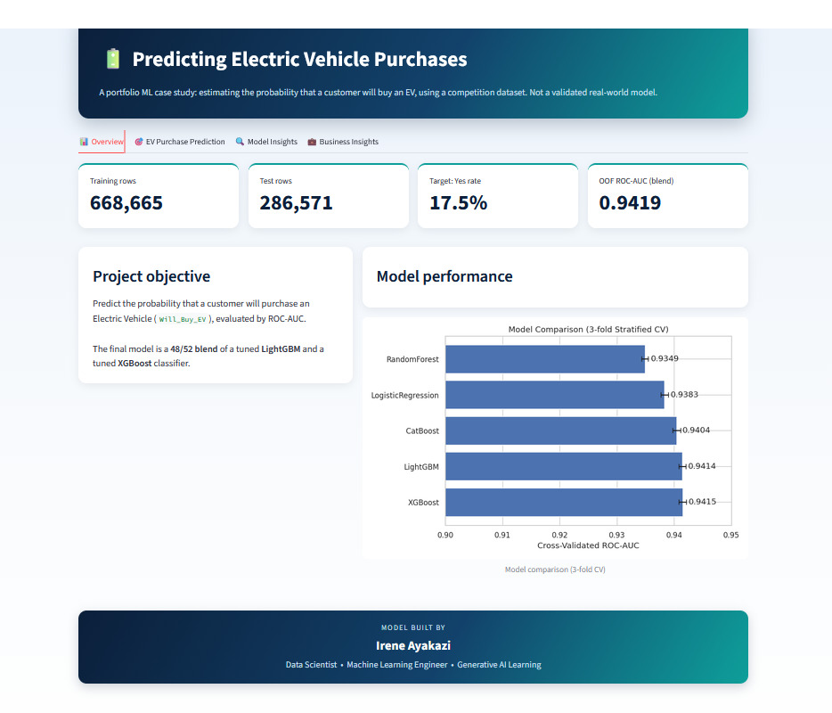
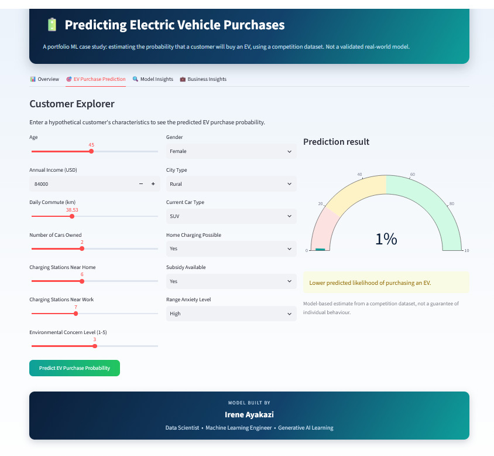
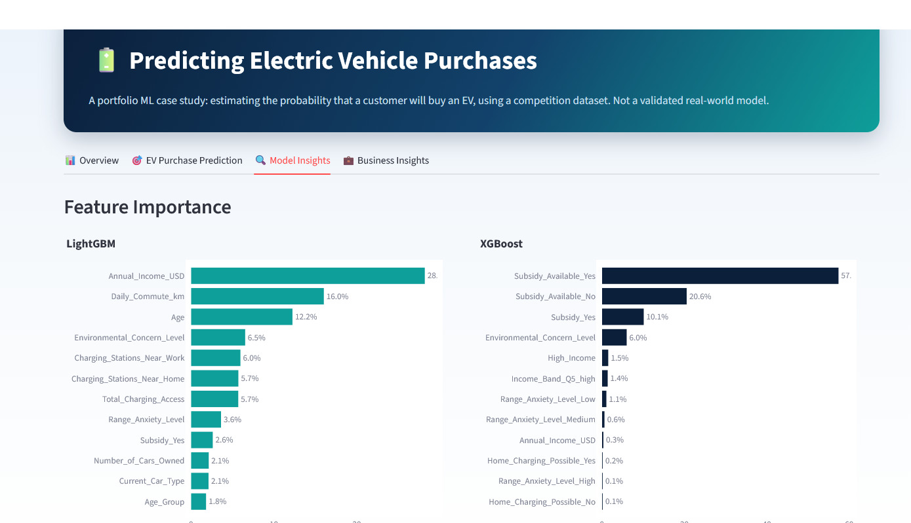
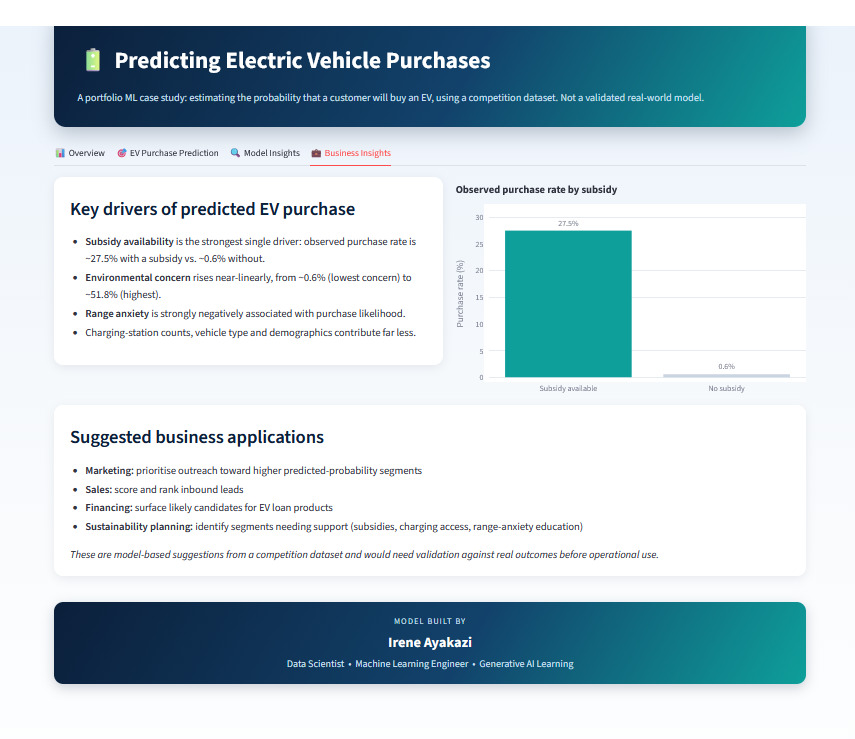

# Electric Vehicle Purchase Prediction


An end-to-end machine learning project that predicts the likelihood of a customer indicating they would purchase an electric vehicle (EV). The project covers exploratory data analysis, feature engineering, model comparison, hyperparameter tuning, ensembling, explainability, calibration, error analysis, fairness evaluation, and an interactive Streamlit dashboard.

**Final blended out-of-fold ROC-AUC: 0.9419**

The final model combines LightGBM and XGBoost.

> **Important:** This is a Kaggle-style competition dataset, not verified real-world purchase data. The results demonstrate a machine learning workflow and should not be interpreted as proof of actual consumer behaviour or causal relationships.

---

## Interactive Dashboard

The Streamlit dashboard allows users to explore model performance, understand important features, and generate predictions for hypothetical customer profiles.

### 1. Dashboard Overview



Five models were compared using stratified cross-validation. XGBoost and LightGBM achieved the strongest baseline ROC-AUC scores.

### 2. Customer Explorer — Live Prediction



Users can enter customer characteristics and receive an estimated probability of EV purchase. In the example shown, the predicted probability is 5.5%. This is a model estimate, not a guarantee of individual behaviour.

### 3. Model Insights




Explores model feature importance and the factors associated with predicted purchase likelihood.

### 4. Business Insights




Presents observed relationships between EV purchase willingness, subsidy availability, environmental concern, and range anxiety.

---

## Business Problem

Can machine learning identify customers who are more likely to indicate that they would purchase an EV based on their demographic, financial, vehicle, environmental, and charging-access characteristics?

Potential applications include:

- **EV manufacturers and dealerships:** Prioritise customer outreach.
- **Marketing teams:** Explore customer segments for targeted campaigns.
- **EV financing providers:** Understand potential interest in EV financing.
- **Policy and sustainability teams:** Investigate patterns relevant to EV adoption.

The model supports exploratory analysis and should not be used alone for consequential decisions or infrastructure investment.

## Dataset

- `train.csv`: 668,665 rows and 15 columns, including the target.
- `test.csv`: 286,571 rows and 14 feature columns, without target labels.
- The source data was checked for missing values and duplicate rows or IDs.
- Features include age, annual income, daily commute distance, vehicle ownership, charging-station access, environmental concern, gender, city type, home charging, subsidy availability, and range anxiety.

### Target Variable and Class Imbalance

The target variable is `Will_Buy_EV`:

- `Yes = 1`: Indicates willingness to purchase an EV.
- `No = 0`: Indicates unwillingness to purchase an EV.

The target distribution is approximately 17.5% Yes and 82.5% No.

Class weighting was tested but did not improve ROC-AUC:

| Approach | ROC-AUC |
|---|---:|
| Without class weighting | 0.9418 |
| With class weighting | 0.9417 |

The final approach retained the original class distribution.

ROC-AUC measures how well a model ranks positive cases above negative cases across different classification thresholds.

## Exploratory Data Analysis

### Target Distribution


### Numeric Feature Distributions


### Categorical Feature Distributions


### Purchase Rate by Key Drivers


Selected observed purchase-willingness rates:

| Feature | Observed rate |
|---|---:|
| Subsidy available | 27.5% |
| No subsidy available | 0.6% |
| Environmental concern level 5 | 51.8% |
| Environmental concern level 1 | 0.6% |
| Low range anxiety | 18.9% |
| High range anxiety | 0.1% |

These figures represent associations in the dataset, not causal effects.

### Correlation Analysis


## Feature Engineering

New features were created from existing row-level information without using the target variable:

- `Age_Group`: Groups customers by age.
- `Income_Band`: Groups customers by income.
- `Total_Charging_Access`: Combines home and work charging-station counts.
- `Commute_Intensity`: Groups daily commute distance.
- `Subsidy_x_MidLowIncome`: Tests the interaction between subsidy availability and below-median income.
- `Multi_Car_Household`: Identifies households owning two or more cars.

## Model Development and Validation

Stratified 3-fold cross-validation was used to preserve the class distribution in each fold and manage computational costs.

### Baseline Model Comparison


| Model | Mean CV ROC-AUC | Standard deviation |
|---|---:|---:|
| XGBoost | 0.9415 | 0.0006 |
| LightGBM | 0.9414 | 0.0006 |
| CatBoost | 0.9404 | 0.0007 |
| Logistic Regression | 0.9383 | 0.0007 |
| Random Forest | 0.9349 | 0.0005 |

Optuna was used to tune LightGBM and XGBoost, optimising ROC-AUC. Each tuned model achieved a reported validation AUC of approximately 0.9417.

### Ensembling and Final Performance

The final blend combined:

- 48% LightGBM predictions
- 52% XGBoost predictions

The blend achieved a reported out-of-fold ROC-AUC of **0.9419**, a small improvement over the individual models.

### ROC Curve


A ROC-AUC of 0.9419 indicates strong ranking performance on the evaluation data. It does not mean that 94.19% of predictions are correct.

## Model Explainability

### Feature Importance


### SHAP Summary


The analyses highlighted subsidy-related features, environmental concern, annual income, and range anxiety. Feature importance describes model behaviour and associations; it does not establish causation.

## Model Calibration


Predicted probabilities from tuned LightGBM were compared with observed frequencies across 10 quantile bins on a hold-out set. Calibration was reported as close to the ideal diagonal, so a separate isotonic or Platt calibration step was not applied.

## Error Analysis and Fairness

The reported hold-out analysis found:

- 74.8% of predictions were high-confidence and correct.
- 2.5% were high-confidence but incorrect.
- 6.1% fell within the uncertain probability range of 0.40–0.60.

### Performance by City Type

- Urban ROC-AUC: 0.945
- Rural ROC-AUC: 0.937

The reason for this difference has not been established and requires further investigation.

### Performance by Gender

- Female ROC-AUC: 0.9418
- Male ROC-AUC: 0.9419
- Other ROC-AUC: 0.9294

The Other group had a substantially smaller sample size, approximately 1,034 customers in the reported analysis. Its performance estimate is therefore less certain. Further subgroup evaluation is necessary before consequential use.

## Limitations

- The dataset is a single snapshot and does not confirm actual EV purchases or track behaviour over time.
- Three-fold cross-validation was used to reduce computing time.
- CatBoost was trained with fewer iterations and received less extensive tuning.
- Fairness estimates for the smaller gender group are less certain.
- Observed relationships do not establish causal effects.
- Real-world deployment would require validation on representative data and ongoing performance monitoring.

## Deployment

The Streamlit application is located at `app/app.py`. It allows users to enter hypothetical customer details, view estimated EV purchase probabilities, and explore model performance and explainability information.

## Project Structure

```text
EV-Purchase-Prediction/
├── data/
├── notebooks/
│   └── EV_Purchase_Prediction.ipynb
├── src/
│   ├── data_preprocessing.py
│   ├── feature_engineering.py
│   ├── train.py
│   ├── tune.py
│   ├── generate_tuned_oof.py
│   ├── imbalance_check.py
│   ├── evaluate.py
│   ├── make_plots.py
│   ├── make_model_plots.py
│   └── predict.py
├── models/
├── outputs/
│   ├── submission.csv
│   ├── feature_importance.csv
│   ├── model_comparison.csv
│   └── figures/
├── app/
│   └── app.py
├── requirements.txt
├── README.md
└── .gitignore
```

## Technologies Used

Python 3.12, Pandas, NumPy, scikit-learn, LightGBM, XGBoost, CatBoost, SHAP, Optuna, Matplotlib, Seaborn, and Streamlit.

## How to Run

Install dependencies from the repository root:

```bash
pip install -r requirements.txt
```

Launch the dashboard:

```bash
streamlit run app/app.py
```

### Training Workflow

The following commands reflect the project's training workflow. Check each script's available arguments if your local version differs.

```bash
# Compare baseline models
python src/train.py --model LightGBM

# Tune hyperparameters
python src/tune.py --model lightgbm --n_trials 20

# Generate out-of-fold predictions
python src/generate_tuned_oof.py --model lightgbm_tuned

# Run evaluation and analysis
python src/evaluate.py

# Train the final blend and generate submission.csv
python src/predict.py
```

## Future Improvements

- Evaluate with 5-fold cross-validation and tune CatBoost more extensively.
- Test predictions against real-world EV purchase outcomes.
- Explore additional market and geographic data.
- Expand fairness evaluation using larger, representative samples.
