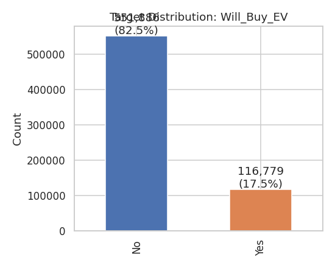
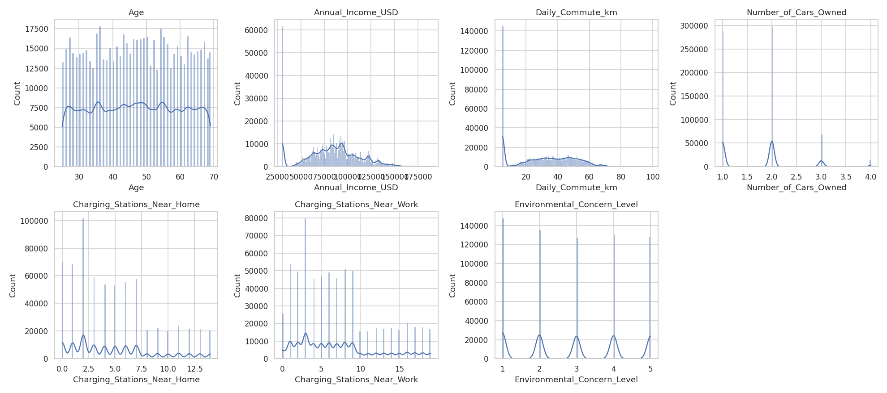
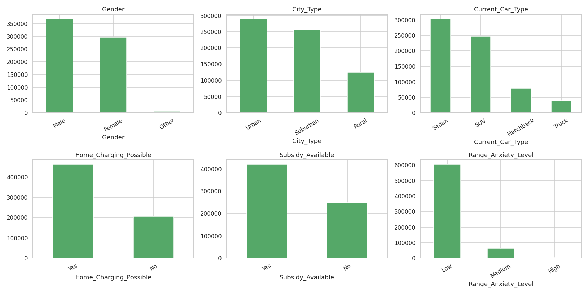
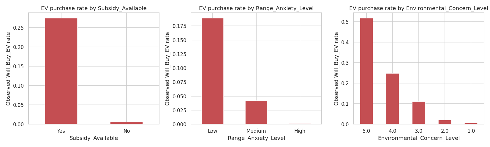
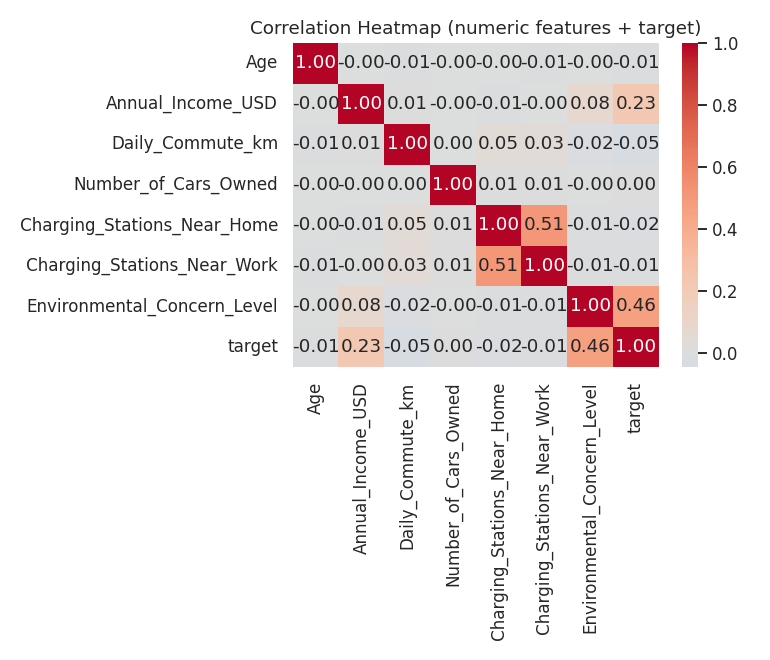
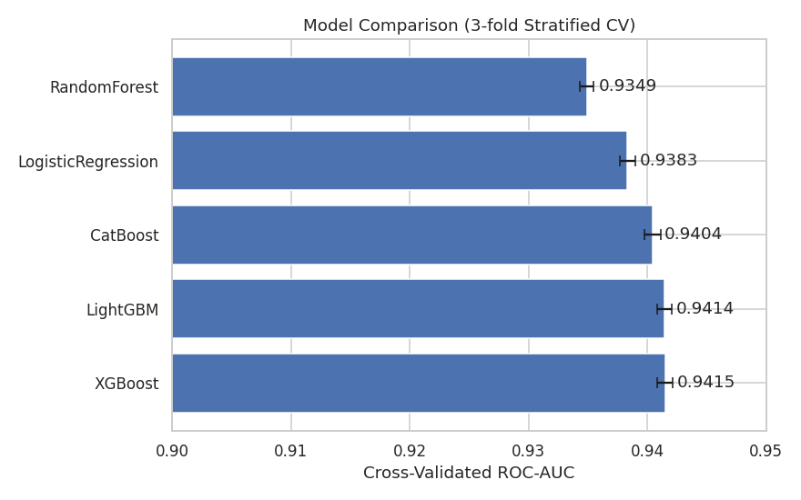
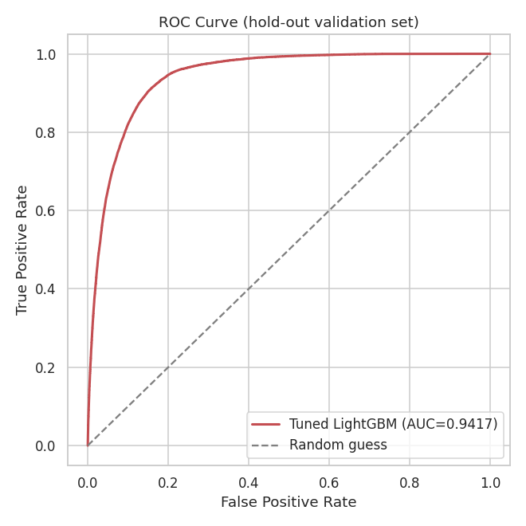
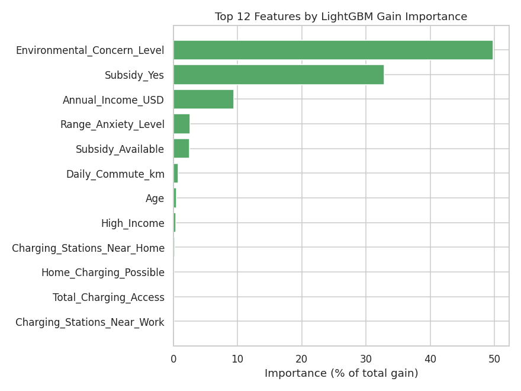
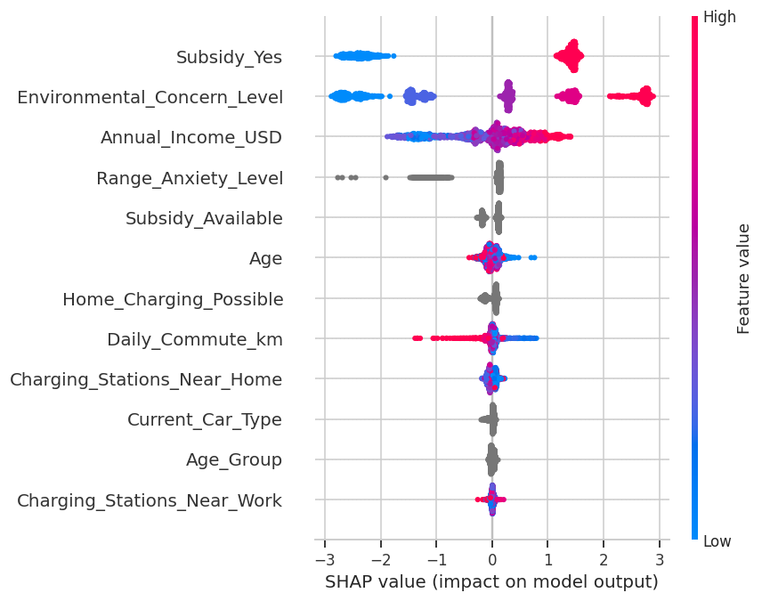
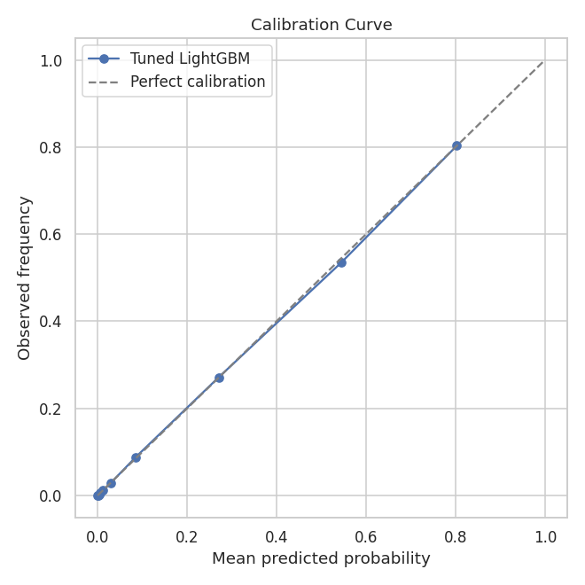

# Electric Vehicle Purchase Prediction


An end-to-end machine learning project that estimates the probability of a customer indicating they would purchase an electric vehicle (EV). It covers exploratory data analysis, feature engineering, model comparison, hyperparameter tuning, ensembling, model explainability, error analysis, fairness checks, and a Streamlit dashboard.

**Final blended out-of-fold ROC-AUC: 0.9419** using LightGBM and XGBoost.

> **Important context:** This is a Kaggle-style competition dataset, not verified real-world purchase data. Results describe patterns in this dataset and should not be interpreted as proven consumer behaviour or causal effects. Real-world use would require validation on representative, real purchase data.

## Interactive Dashboard

The Streamlit dashboard presents model results, lets users explore feature insights, and generates a prediction for a hypothetical customer profile.

### Dashboard overview


Five models were compared using 3-fold stratified cross-validation. XGBoost and LightGBM had the highest baseline ROC-AUC scores, and a blend of tuned versions produced a small improvement.

### Customer explorer: live prediction


Users can enter a hypothetical customer profile and view the model's estimated purchase probability. In the example shown, the predicted probability is **5.5%**. This is a model estimate, not a guarantee of an individual's behaviour.

### Model insights


Feature importance varies by model and importance method. Across the analyses, subsidy availability, environmental concern, income, and range anxiety were among the important predictive signals.

### Business insights


In this dataset, the observed purchase rate was approximately 27.5% where a subsidy was available and 0.6% where it was not. Rates also varied with environmental concern and range anxiety. These are associations in the dataset, not evidence that any single factor causes a purchase.

## Business Problem

Can machine learning rank customers by their likelihood of indicating that they would purchase an EV, using demographic, financial, vehicle, environmental, and charging-access features?

Potential applications include:

- **EV manufacturers and dealerships:** prioritise customer outreach and offers.
- **Marketing teams:** identify groups for further research and targeted campaigns.
- **EV financing providers:** understand potential interest in EV finance products.
- **Policy and sustainability teams:** explore patterns that may warrant further investigation.

The model should support analysis rather than make consequential decisions on its own. The dataset does not contain enough geographic and market information to determine where charging stations should be built.

## Dataset

- `train.csv`: 668,665 rows and 15 columns, including the target.
- `test.csv`: 286,571 rows and 14 feature columns, without target labels.
- The source files were checked for missing values and duplicate rows or IDs.
- Features include age, annual income, commute distance, number of cars owned, charging-station counts, environmental concern, gender, city type, current car type, home charging possibility, subsidy availability, and range anxiety.

### Target and class imbalance

The target is `Will_Buy_EV`:

- `Yes = 1`: indicates willingness to buy an EV.
- `No = 0`: indicates unwillingness to buy an EV.

The target distribution is approximately **17.5% Yes** and **82.5% No**. Class weighting was tested but did not improve ROC-AUC: the reported score was 0.9418 without weighting and 0.9417 with weighting. The final approach therefore retained the original class distribution.

ROC-AUC was used because the competition evaluates predicted probabilities and the metric measures how well the model ranks positive cases above negative cases across thresholds. Predictions were not thresholded at 0.5 for the competition submission.

## Exploratory Data Analysis







Selected observed purchase rates:

| Feature group | Observed `Will_Buy_EV` rate |
|---|---:|
| Subsidy available | 27.5% |
| No subsidy available | 0.6% |
| Environmental concern level 5 | 51.8% |
| Environmental concern level 1 | 0.6% |
| Low range anxiety | 18.9% |
| High range anxiety | 0.1% |

These figures show associations in this dataset; they do not establish causation.

## Feature Engineering

New features were derived from information already present in each row, without using the target:

- `Age_Group` and `Income_Band`: grouped age and income values.
- `Total_Charging_Access`: combined home and work charging-station counts.
- `Commute_Intensity`: grouped daily commute distance.
- `Subsidy_x_MidLowIncome`: interaction between subsidy availability and below-median income.
- `Multi_Car_Household`: indicator for owning two or more cars.

## Model Development and Validation

Stratified 3-fold cross-validation was used to preserve the target class balance in each fold. This was selected to manage computing time. The data was treated as a single-snapshot binary classification problem; the available columns did not indicate a time-based or grouped split requirement.

### Baseline model comparison

| Model | Mean CV ROC-AUC | CV ROC-AUC standard deviation |
|---|---:|---:|
| XGBoost | 0.9415 | 0.0006 |
| LightGBM | 0.9414 | 0.0006 |
| CatBoost | 0.9404 | 0.0007 |
| Logistic Regression | 0.9383 | 0.0007 |
| Random Forest | 0.9349 | 0.0005 |



Optuna was used to tune LightGBM and XGBoost with ROC-AUC as the optimization metric. After approximately 18–20 trials per model, each tuned model achieved a reported validation AUC of 0.9417.

### Ensembling and final performance

The final blend combined **48% LightGBM** and **52% XGBoost** predictions. The weights were selected by testing combinations. The blend achieved a reported **out-of-fold ROC-AUC of 0.9419**, a small improvement over the individual models.



A ROC-AUC of 0.9419 indicates strong ranking performance on the evaluation data: a randomly selected positive example is generally ranked above a randomly selected negative example. It does not mean that 94.19% of predictions are correct.

## Explainability and Calibration




Native gain-based importance and SHAP analyses highlighted subsidy-related features, environmental concern, annual income, and range anxiety. Feature importance describes model associations and should not be interpreted as causal evidence.

Predicted probabilities from tuned LightGBM were checked against observed frequencies across 10 quantile bins on a hold-out set. Calibration was reported as close to the ideal diagonal; a separate isotonic or Platt calibration step was not applied because it was not expected to provide meaningful improvement.



## Error Analysis and Fairness Checks

On the reported hold-out evaluation:

- **74.8%** of predictions were high-confidence and correct.
- **2.5%** were high-confidence but incorrect.
- **6.1%** had probabilities in the uncertain 0.40–0.60 range.

Reported ROC-AUC by city type was **0.945 for Urban** and **0.937 for Rural**. The reason for this difference has not been established and would require further investigation.

Reported ROC-AUC by gender was **0.9418 for Female**, **0.9419 for Male**, and **0.9294 for Other**. The Other group was much smaller (approximately 1,034 customers in the reported analysis), so its result is less certain. Subsidy availability and environmental concern may also correlate with demographic or socioeconomic characteristics. Further fairness testing would be necessary before any consequential use.

## Limitations

- The dataset is a single snapshot and does not confirm actual EV purchases or track behaviour over time.
- Three-fold cross-validation was used to reduce computing time.
- CatBoost used fewer training iterations and was not tuned as extensively as LightGBM and XGBoost.
- Fairness estimates for the smaller gender group are less certain.
- Findings are associations, not causal effects, and require validation on representative real-world data before deployment in business decisions.

## Deployment

The Streamlit application is located at `app/app.py`. It allows users to enter example customer details, view an estimated purchase probability, and explore model performance and explainability information.

## Project Structure

```text
EV-Purchase-Prediction/
├── data/                  # Dataset files
├── notebooks/
│   └── EV_Purchase_Prediction.ipynb
├── src/
│   ├── data_preprocessing.py
│   ├── feature_engineering.py
│   ├── train.py
│   ├── tune.py
│   ├── generate_tuned_oof.py
│   ├── imbalance_check.py
│   ├── evaluate.py
│   ├── make_plots.py
│   ├── make_model_plots.py
│   └── predict.py
├── models/                # Saved model artifacts
├── outputs/
│   ├── submission.csv
│   ├── feature_importance.csv
│   ├── model_comparison.csv
│   └── figures/
├── app/
│   └── app.py
├── requirements.txt
├── README.md
└── .gitignore
```

## Technologies

Python 3.12, Pandas, NumPy, scikit-learn, LightGBM, XGBoost, CatBoost, SHAP, Optuna, Matplotlib, Seaborn, and Streamlit.

## How to Run

Create and activate a Python environment, then install the dependencies:

```bash
pip install -r requirements.txt
```

Run the dashboard:

```bash
streamlit run app/app.py
```

The following commands show the training workflow used in this project. Run them from the repository root and check each script's available arguments if needed:

```bash
# Compare baseline models
python src/train.py --model LightGBM

# Tune hyperparameters
python src/tune.py --model lightgbm --n_trials 20

# Generate out-of-fold predictions
python src/generate_tuned_oof.py --model lightgbm_tuned

# Run evaluation and analysis
python src/evaluate.py

# Train the final blend and create submission.csv
python src/predict.py
```

## Future Improvements

- Evaluate with 5-fold cross-validation and tune CatBoost more extensively when computing resources allow.
- Test the model against real-world purchase outcomes and assess performance drift over time.
- Explore additional market and geographic data for more robust business insights.
- Expand fairness and subgroup evaluation using larger, representative samples.
